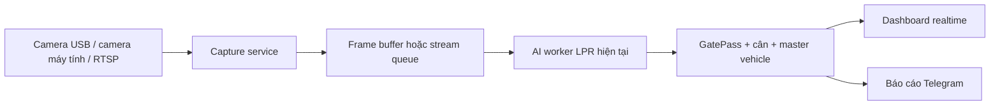

# Workflow demo — nhận diện biển số từ video

Tài liệu này mô tả đúng luồng đang chạy trong bản MVP hiện tại. Hệ thống nhận video upload, xử lý bằng Python worker, rồi trả kết quả về dashboard React.

## Sơ đồ tổng thể

```mermaid
flowchart LR
    A[Người dùng chọn video] --> B[React upload multipart]
    B --> C[NestJS lưu vào storage/uploads]
    C --> D[Tạo VideoJob: PENDING]
    D --> E{Worker slot còn trống?}
    E -- Chưa --> F[Chờ trong hàng đợi]
    F --> E
    E -- Có --> G[Khởi động Python worker]

    G --> H[Đọc metadata video]
    H --> I[Đọc frame mẫu theo LPR_SAMPLE_SECONDS]
    I --> J[YOLO phát hiện vùng biển số]
    J --> K[RapidOCR đọc ký tự]
    K --> L[Gom các frame thành track của từng xe]
    L --> M{Đủ điều kiện xác nhận?}
    M -- Chưa --> N[Bỏ track hoặc tiếp tục theo dõi]
    N --> I
    M -- Có --> O[Chọn frame tốt nhất]

    O --> P[Cắt ảnh biển số và ảnh xe]
    P --> Q[Đóng khung bằng chứng trên ảnh]
    Q --> R[Worker trả JSON kết quả]
    R --> S[NestJS cập nhật VideoJob]
    S --> T[SSE gửi sự kiện nhận diện]
    S --> U[API trả trạng thái và kết quả]
    T --> V[React cập nhật kết quả realtime]
    U --> V
    V --> W[Hiển thị biển số, confidence, thời gian và ảnh bằng chứng]
```



## Điều kiện xác nhận biển số

Một track được xác nhận khi thỏa một trong hai điều kiện:

- Có ít nhất 2 quan sát đồng ý cùng một biển số.
- Có 1 quan sát rất rõ: OCR từ 90% trở lên và detector từ `LPR_MIN_DETECTOR_CONF` trở lên (mặc định 40%).

Nếu chỉ có OCR cao nhưng detector thấp, hệ thống không nên tự chốt kết quả. Đây là điểm kiểm soát để giảm nhận nhầm chữ trên nền hoặc biển số bị mờ.

## Các trạng thái job video

```text
PENDING → PROCESSING → COMPLETED
                    ├→ FAILED
                    └→ CANCELLED
```

- `PENDING`: video đã lưu, đang chờ worker.
- `PROCESSING`: worker đang đọc frame và phát hiện biển số.
- `COMPLETED`: worker trả kết quả, ảnh bằng chứng đã lưu.
- `FAILED`: lỗi model, Python, video hoặc dữ liệu worker trả về.
- `CANCELLED`: người dùng bấm dừng hoặc job bị dừng cưỡng bức.

## Những gì dashboard hiển thị

Khi worker xác nhận được xe, dashboard nhận sự kiện qua `GET /api/live/events` và cập nhật:

1. Biển số đã đọc.
2. Confidence tổng hợp, detector confidence và OCR confidence.
3. Thời điểm đầu/cuối phát hiện trong video.
4. Ảnh crop biển số.
5. Ảnh xe và ảnh toàn cảnh có khung biển số.
6. Loại xe hoặc loại đá nếu model tương ứng đã được bật.

Video kết quả hiện vẫn là video gốc được lưu ở thư mục kết quả; khung bằng chứng nằm ở ảnh snapshot và dữ liệu overlay của dashboard.

## Kịch bản demo 3 phút

### 1. Mở hệ thống

Mở `http://localhost:5173` và vào menu **Realtime**.

### 2. Upload video

Chọn video mẫu `13275193-hd_1920_1080_60fps.mp4`, sau đó bấm **Bắt đầu nhận diện**.

Nói khi demo:

> Giao diện gửi video lên NestJS. API lưu file, tạo job và đưa job vào hàng đợi. Worker Python sẽ xử lý độc lập để giao diện không bị treo.

### 3. Giải thích trạng thái xử lý

Trong lúc chạy, hiển thị progress và trạng thái `PROCESSING`.

Nói:

> Worker không đọc toàn bộ frame ở tốc độ 60 FPS. Hệ thống lấy frame mẫu, YOLO tìm biển số, RapidOCR đọc ký tự, sau đó gom các lần đọc của cùng một xe thành một track.

### 4. Hiển thị kết quả

Khi có kết quả, chỉ vào ảnh biển số và các confidence.

Nói:

> Hệ thống chỉ chốt khi có nhiều quan sát đồng ý hoặc một frame duy nhất đủ rõ cả detector và OCR. Vì vậy confidence OCR cao không đồng nghĩa detector cũng chắc chắn.

### 5. Chốt phạm vi MVP

Nói rõ:

> Bản hiện tại đã xử lý video upload. Camera máy tính, RTSP và camera IP sẽ được nối ở bước tiếp theo bằng cách thay nguồn video upload bằng một camera capture service, còn pipeline nhận diện giữ nguyên.

## Cấu hình demo an toàn

Trong `.env`, dùng các giá trị sau:

```env
HOST=127.0.0.1
CORS_ORIGINS=http://localhost:5173,http://127.0.0.1:5173
MAX_CONCURRENT_VIDEO_JOBS=1
MATERIAL_ZERO_SHOT=false
WEIGHBRIDGE_MOCK_RANDOM=false
```

Nếu muốn trình diễn luồng cân giả lập, chỉ bật tạm thời:

```env
WEIGHBRIDGE_MOCK_RANDOM=true
```

Sau demo nên tắt lại. Trạm cân thật sẽ gửi dữ liệu vào `POST /api/gate/weighbridge/readings`.

## Luồng mở rộng sau MVP



Luồng mở rộng này chưa phải phần đang chạy trong bản demo hiện tại; nó là kiến trúc kế tiếp để kết nối camera thật.
